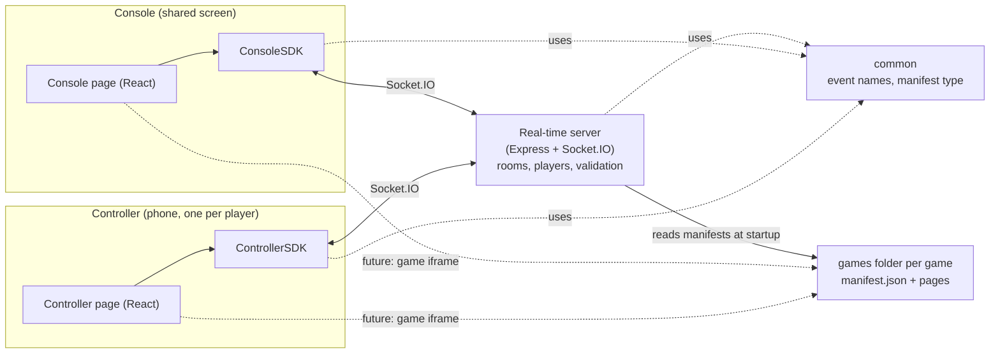
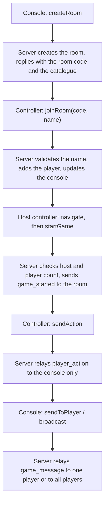

# Architecture

PanicControl is a browser game console. A shared screen (the **console**) hosts the game, and the
players' phones (the **controllers**) send inputs through a real-time server. This page describes how
the pieces fit together. For setup and scripts, see the [README](../../README.md).

## Components

- **Console page and controller pages** are routes of the same React app (`client_host/`). They never
  use Socket.IO directly: everything goes through the SDK.
- **SDK** (`sdk/`) exposes `ConsoleSDK` and `ControllerSDK`. See [SDK architecture](sdk-architecture.md).
- **Server** (`server/`) is the single source of truth for rooms and players. It validates every
  payload and relays messages. See [Server](server.md).
- **`common/`** holds the socket event names (`eventsCodes.ts`) and the manifest type and lists
  (`gameManifest.ts`), shared by the server and the SDK.
- **`games/`** holds game packages. The server reads their manifests at startup to build the
  catalogue. The game pages themselves are not loaded yet (see [Not yet available](#not-yet-available)).

## Data flows

- **Join**: the console creates a room and shows the code and a QR code. A controller joins with the
  code and a name. The first player to join becomes the host.
- **Game start**: only the host player starts the game. The server checks the player count against the
  manifest and notifies the whole room.
- **An action**: a controller sends `send_action`. The server adds the player id from its own state
  and forwards it to the console only.
- **A private message**: the console sends `send_private_message` with a player id. The server
  forwards it to that player's socket only.

Event details, payloads and sequence diagrams are in [Real-time protocol](realtime-protocol.md).

## Stack

| Technology                   | Version               | Why                                                                                                              |
| ---------------------------- | --------------------- | ---------------------------------------------------------------------------------------------------------------- |
| Node.js                      | 22 (`node:22-alpine`) | One language across server, SDK and web app. README requires 22.9+ and npm 10+.                                  |
| Express                      | ^5.3.0                | Minimal HTTP layer; today it only serves a health route.                                                         |
| Socket.IO / socket.io-client | ^4.8.4                | Rooms, acknowledgements, automatic reconnection and fallback transports, useful on phone networks.               |
| glin-profanity               | ^4.0.1                | Player name filter (French and English) without maintaining our own word lists.                                  |
| React                        | ^19.3.1               | Component model for the console and controller pages.                                                            |
| react-router-dom             | ^7.18.5               | Routing between home, console and controller pages.                                                              |
| Vite                         | ^8.3.5                | Fast dev server and static build served by nginx.                                                                |
| TypeScript                   | ^7.0.2 (root ^6.0.3)  | Strict typing, important for a public SDK API.                                                                   |
| tsdown                       | ^0.23.4               | Bundles the server into `dist/server.mjs` together with the raw-TS `common`; builds the SDK (ESM, CJS, `.d.ts`). |
| Vitest                       | ^5.1.0                | One runner for all packages, native TypeScript. A root config runs every package with one `npm test`.            |
| ESLint / Prettier            | ^9 / ^3               | Lint (`--max-warnings=0`) and formatting enforced by hooks and CI.                                               |
| Husky + commitlint           |                       | Git hooks checking code and Conventional Commits messages.                                                       |

## Repository layout

| Folder         | Role                                                           |
| -------------- | -------------------------------------------------------------- |
| `common/`      | Socket event names and manifest type, shared as raw TypeScript |
| `server/`      | Real-time server                                               |
| `sdk/`         | `ConsoleSDK` and `ControllerSDK`                               |
| `client_host/` | React web app: home, console page, controller page             |
| `games/`       | Game packages (manifest and pages)                             |
| `docs/`        | Documentation                                                  |

Dependency direction: `common` is used by `server` and `sdk`; `sdk` is used by `client_host`. There
are no npm workspaces: packages are linked with `file:` dependencies and each has its own
`package.json` and lockfile. When the protocol changes, the change goes through `common`, then the
server, the SDK and the web app, in that order.

## Deployment

| Stack                        | Services                                                                | Ports (host)                                 |
| ---------------------------- | ----------------------------------------------------------------------- | -------------------------------------------- |
| `compose.yaml` (production)  | `server` (Node, healthcheck) and `web` (nginx serving the static build) | `${SERVER_PORT:-3000}`, `${WEB_PORT:-8080}`  |
| `compose.dev.yaml` (develop) | `server` with `tsx watch`, `web` with the Vite dev server               | `${SERVER_PORT:-3000}`, `${VITE_PORT:-5173}` |

- `web` waits for the `server` healthcheck. The server container reads an optional `server/.env`.
- The `VITE_SERVER_URL`, `VITE_PUBLIC_URL` and `VITE_SDK_DEBUG` variables are build arguments of the
  web image, written into the JavaScript at build time. Change them, then rebuild.
- `server/Dockerfile` has a build stage and a runtime stage. It copies `common/` and `games/`, runs
  as the unprivileged user `node`, exposes 3000 and starts `node dist/server.mjs`.
- `client_host/Dockerfile` builds the SDK, then the app, and serves the result with nginx.
- The development stack uses Compose Watch: it syncs `server/src`, `common`, `games`,
  `client_host/src` and `public`, and rebuilds when a `package.json` or the SDK changes.

Environment variables are listed in [Server](server.md#configuration) and in
`client_host/.env.example`.

## CI pipeline

Defined in `.github/workflows/ci.yml`. It runs on every pull request into `develop` or `main`, on
Node 22. A new run cancels the one still in progress for the same ref.

| Job                | What it does                                                                                                                                                                     |
| ------------------ | -------------------------------------------------------------------------------------------------------------------------------------------------------------------------------- |
| Lint and Format    | `npm ci`, ESLint with `--max-warnings=0`, then `format:check`                                                                                                                    |
| Tests and Coverage | `npm ci` in each package, builds the SDK, the server and the web app in that order, then `npm test`                                                                              |
| Development stack  | Starts `compose.dev.yaml`, checks the Vite and server ports and the Socket.IO handshake, checks that Compose Watch syncs an edit into both containers, then tears the stack down |

The job is named "Tests and Coverage" but there is no coverage step yet.

## Decisions

Architecture decisions are recorded in [docs/adr/](../adr/). Current record:
[ADR 0001: game packages and launch](../adr/0001-game-packages-and-launch.md) (package format, launch
flow, channel abstraction, alternatives). Team rules: [commit rules](../COMMIT_RULES.md),
[good practice](../GOOD_PRACTICE.md), [CONTRIBUTING](../../CONTRIBUTING.md).

## Not yet available

- Loading and running game pages (`entry.screen`, `entry.controller`) in sandboxed iframes.
- Accounts, profiles and persistence: the server keeps everything in memory.
- Coverage reporting in CI, and deployment jobs.
- Several server instances: room state lives in one process.
