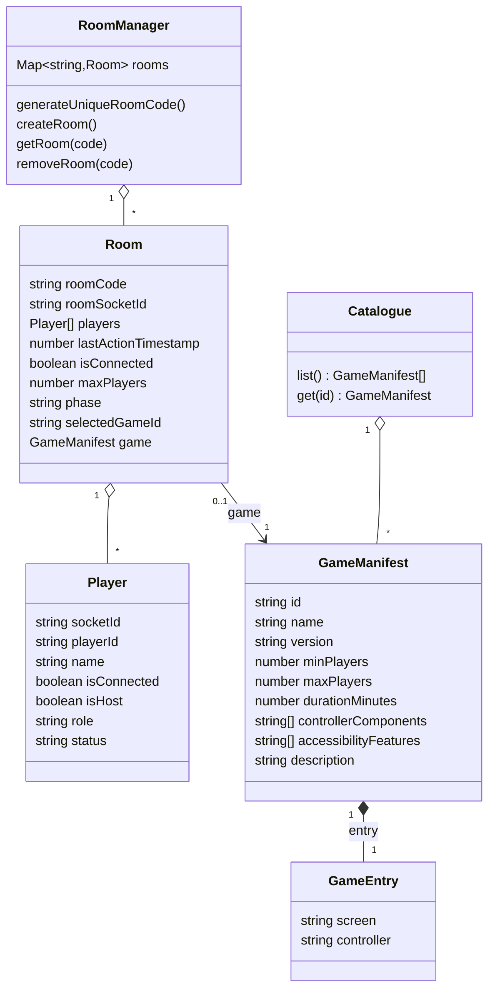
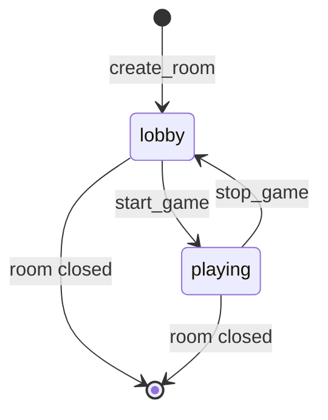

# Data model

All state lives in the server's memory. Nothing is persisted: restarting the server closes every
room. Source files are in `server/src/realtime/` and `server/src/games/`.

## Room phase

There is no "closed" phase: a closed room is removed from the `RoomManager` map. A room is closed
when its console stays offline for 30 seconds or when it is inactive for 15 minutes.

## Field dictionary

### Room

| Field                 | Type                     | Meaning                                                                   |
| --------------------- | ------------------------ | ------------------------------------------------------------------------- |
| `roomCode`            | string                   | 6-character code shown on the console                                     |
| `roomSocketId`        | string                   | Socket id of the console                                                  |
| `players`             | `Player[]`               | Players in the room, including those disconnected within the grace period |
| `lastActionTimestamp` | number (ms)              | Last activity, used for inactivity cleanup                                |
| `isConnected`         | boolean                  | Whether the console is online                                             |
| `disconnectTimer`     | timer, optional          | 30-second timer started when the console disconnects                      |
| `maxPlayers`          | number, read-only        | Room capacity (`MAX_PLAYERS_PER_ROOM`, default 8)                         |
| `phase`               | `'lobby'` or `'playing'` | Current phase                                                             |
| `selectedGameId`      | string or null           | Game highlighted in the catalogue; set to the first game at creation      |
| `game`                | `GameManifest` or null   | Manifest of the running game                                              |

Methods:

| Method                          | Behaviour                                                                                                               |
| ------------------------------- | ----------------------------------------------------------------------------------------------------------------------- |
| `addPlayer`                     | Adds a player; returns false when the room is full                                                                      |
| `removePlayer(socketId)`        | Removes a player                                                                                                        |
| `getPlayersInfos()`             | Returns `{ name, playerId, isConnected, isHost, role, status }` for each player                                         |
| `findPlayer(playerId)`          | Finds a player by stable id                                                                                             |
| `moveSelection(direction, ids)` | Moves the selection (null goes to the first id; up/left previous, down/right next, clamped); returns whether it changed |
| `startGame(manifest)`           | Phase becomes `playing`, stores the manifest, resets every role and status                                              |
| `stopGame()`                    | Phase becomes `lobby`, clears the game, resets roles and statuses                                                       |
| `migrateHost()`                 | Promotes `players[0]` to host                                                                                           |

### Player

| Field             | Type            | Meaning                                                               |
| ----------------- | --------------- | --------------------------------------------------------------------- |
| `socketId`        | string          | Current socket id; changes on reconnection                            |
| `playerId`        | string          | Stable id: supplied by the client when rejoining, otherwise generated |
| `name`            | string          | Player name, validated by the profanity filter                        |
| `isConnected`     | boolean         | False during the grace period after a disconnection                   |
| `isHost`          | boolean         | The host starts and stops games and moves the catalogue selection     |
| `role`            | string or null  | Private: visible to that player and to the console only               |
| `status`          | string or null  | Shared with the console (player list) and that player                 |
| `disconnectTimer` | timer, optional | 30-second timer started when the player disconnects                   |

### RoomManager

| Field / behaviour          | Meaning                                                                             |
| -------------------------- | ----------------------------------------------------------------------------------- |
| `Map<roomCode, Room>`      | All open rooms                                                                      |
| Cleanup interval           | Every 60 s, closes rooms idle for more than 15 min and sends `room_closed`          |
| `generateUniqueRoomCode`   | Draws 6 characters from `ABCDEFGHJKLMNPQRSTUVWXYZ23456789`, unique among open rooms |
| `createRoom`, `removeRoom` | Add and remove a room                                                               |
| `getRoom`                  | Returns a room and refreshes its activity timestamp on every read                   |

### Catalogue

| Member    | Meaning                                               |
| --------- | ----------------------------------------------------- |
| `list()`  | All valid manifests, sorted by name (`localeCompare`) |
| `get(id)` | One manifest by id                                    |

`loadCatalogue(dir)` reads each subfolder of `GAMES_DIR`. A game is kept only if its
`manifest.json` parses and validates, its `id` equals the folder name, and both entry files exist.
Otherwise it is skipped with one warning.

### GameManifest and GameEntry

Field meaning, constraints and examples are in the [manifest reference](../game-dev/manifest.md). In
short: `id`, `name`, `version`, `minPlayers`, `maxPlayers`, `durationMinutes`,
`controllerComponents`, `accessibilityFeatures`, `entry` (`GameEntry` with `screen` and
`controller` paths) and an optional `description`.

## Not yet available

The spec lists entities that do not exist in the code:

- Account (login, hashed password) and profile.
- Match or game session history.
- Score and leaderboard.
- Achievement.
