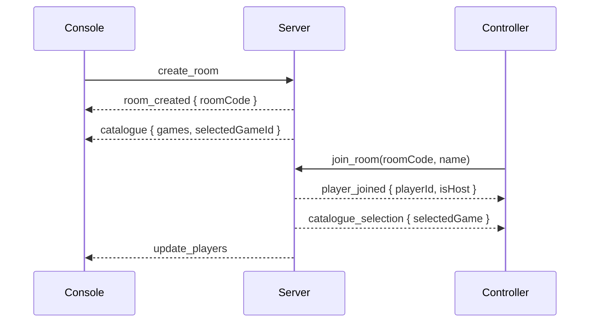
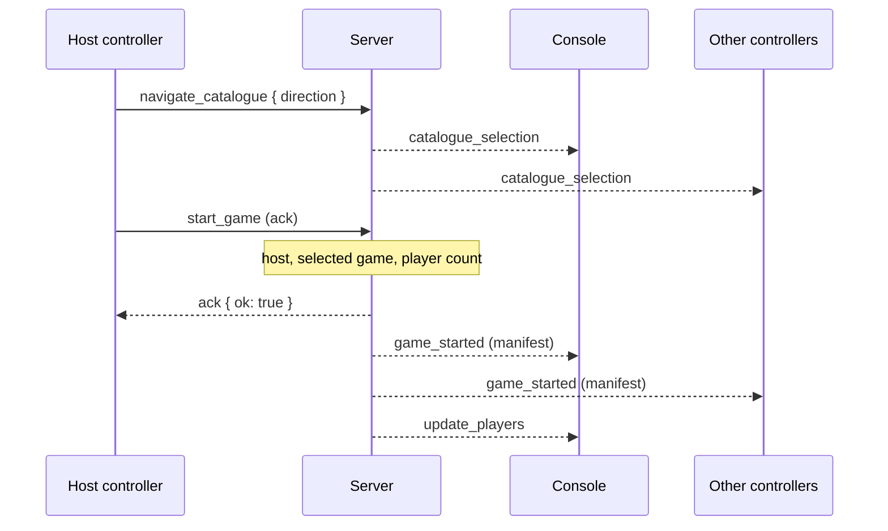
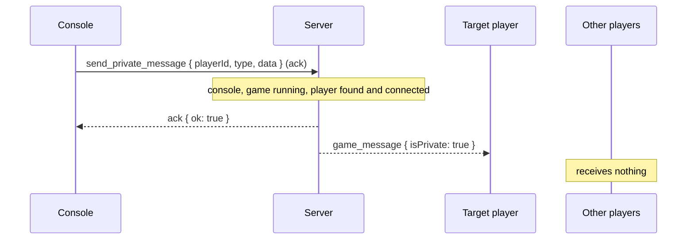
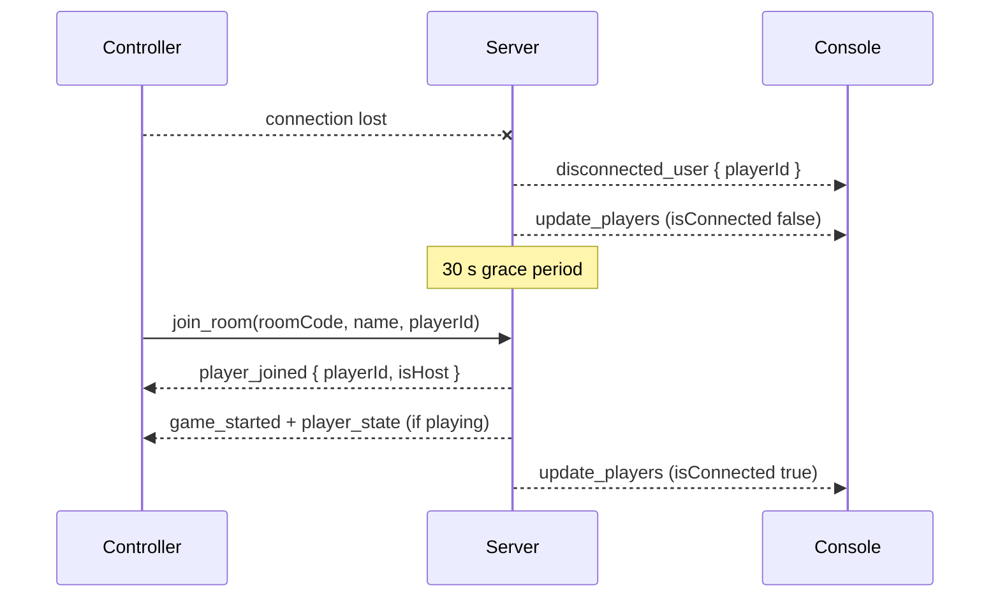
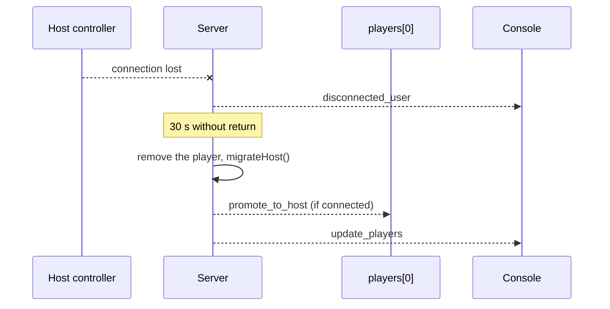

# Real-time protocol

The console, the controllers and the server talk over Socket.IO. Every event name is defined once in
[`common/eventsCodes.ts`](../../common/eventsCodes.ts): `ServerEvents` (client to server) and
`ClientEvents` (server to client). Games never use these names directly: they call the SDK (see the
[SDK reference](../game-dev/sdk-reference.md)). For the architecture, see
[Architecture](architecture.md).

## Conventions

- **Direction**: `ServerEvents` are sent by a client (console or controller) and handled by the
  server. `ClientEvents` are sent by the server.
- **Who sends**: the server decides who may send what. A console can only do console things, a
  player only player things (see the tables below).
- **Acknowledged requests** (newer events) use a Socket.IO acknowledgement. The response is either
  `{ ok: true }` or `{ ok: false, error: { code, message } }`. The SDK waits 5 seconds, then fails
  with `TIMEOUT`.
- **Legacy events** (`create_room`, `join_room`, `reconnect_to_room`) have no acknowledgement. The
  server answers with a success event, or with the `error` event `{ message }`.
- **Fire-and-forget events** (`navigate_catalogue`, `send_action`, `broadcast_message`) have no
  answer. Invalid input is dropped and the server only logs a warning.
- **Identity comes from the server**: the player id in `player_action` is taken from server state,
  never from the payload.

### Error codes

| Code                   | Meaning                                    |
| ---------------------- | ------------------------------------------ |
| `NOT_CONSOLE`          | The action is reserved for the console     |
| `NOT_HOST`             | The action is reserved for the host player |
| `NOT_IN_ROOM`          | The socket is not in a room                |
| `INVALID_PAYLOAD`      | The payload failed validation              |
| `NO_GAME_SELECTED`     | No game is selected in the catalogue       |
| `GAME_ALREADY_RUNNING` | A game is already running                  |
| `NO_GAME_RUNNING`      | The action needs a running game            |
| `NOT_ENOUGH_PLAYERS`   | Fewer players than the game's `minPlayers` |
| `TOO_MANY_PLAYERS`     | More players than the game's `maxPlayers`  |
| `PLAYER_NOT_FOUND`     | No player with that id in the room         |
| `PLAYER_DISCONNECTED`  | The target player is in the grace period   |

Two additional error codes produced by the SDK itself: `TIMEOUT` (no answer in 5 s) and
`BAD_RESPONSE` (malformed answer).

## Client to server (`ServerEvents`)

| Event                  | Sender               | Phase   | Payload                               | Response                         | Recipients of the effect                                 |
| ---------------------- | -------------------- | ------- | ------------------------------------- | -------------------------------- | -------------------------------------------------------- |
| `create_room`          | any socket (console) | any     | none                                  | `room_created`, `catalogue`      | the sender                                               |
| `join_room`            | controller           | any     | `roomCode`, `playerName`, `playerId?` | `player_joined` or `error`       | the sender; console gets `update_players`                |
| `reconnect_to_room`    | console              | any     | `roomCode`                            | `reconnected_to_room` or `error` | console; room gets `console_reconnected`                 |
| `navigate_catalogue`   | host player          | lobby   | `{ direction }` up, down, left, right | none (invalid is ignored)        | room gets `catalogue_selection` if the selection changed |
| `start_game`           | host player          | lobby   | none                                  | ack                              | room gets `game_started`; console gets `update_players`  |
| `stop_game`            | host player          | playing | none                                  | ack                              | room gets `game_stopped`; console gets `update_players`  |
| `send_action`          | connected player     | playing | `{ type, data? }`                     | none (invalid is dropped)        | console only: `player_action`                            |
| `broadcast_message`    | console              | playing | `{ type, data? }`                     | none                             | every player socket: `game_message` (`isPrivate: false`) |
| `send_private_message` | console              | playing | `{ playerId, type, data? }`           | ack                              | that player only: `game_message` (`isPrivate: true`)     |
| `set_player_role`      | console              | playing | `{ playerId, role }`                  | ack                              | that player: `player_state`; console: `update_players`   |
| `set_player_status`    | console              | playing | `{ playerId, status }`                | ack                              | that player: `player_state`; console: `update_players`   |

Details:

- **`create_room`** creates a room and selects the first game of the catalogue. The catalogue is sorted by game name
  (`localeCompare`), so the initially selected game is the first by name.
- **`join_room`** errors, through `error`: `Invalid payload` (`roomCode` or `playerName` not a
  string, `playerId` given but not a string), `Room not found`, `Invalid player name`,
  `This player is already connected.`, `Room is full`. The first
  joiner of an empty room becomes host. With a `playerId` already in the room, the player's seat is restored
  (refused if that player is still connected). An unknown `playerId` is not an error: it is accepted
  as the id of a new player; the socket id and name are updated. On success the
  server sends `player_joined { playerId, isHost }`, then `game_started` plus `player_state` if a game
  is running, or `catalogue_selection` otherwise, and `update_players` to the console. Joining during a
  game is allowed: only the room capacity is checked, not the game's `maxPlayers`.
- **`reconnect_to_room`** errors: `Invalid payload` (`roomCode` not a string),
  `Room not found for reconnection`, `Room is already connected`. The console's 30-second
  disconnection timer is cancelled. On
  success the console receives `reconnected_to_room { roomCode }`, `update_players`, `catalogue`, and
  `game_started` if a game is running. The room then receives
  `console_reconnected { message: 'Console is back online' }`.
- **`start_game`** checks, in order: `NOT_IN_ROOM`, `NOT_HOST` (the console also gets this error),
  `GAME_ALREADY_RUNNING`, `NO_GAME_SELECTED`, `NOT_ENOUGH_PLAYERS`, `TOO_MANY_PLAYERS`. The player count
  includes disconnected players still in their grace period.
- **`stop_game`** can fail with `NOT_IN_ROOM`, `NOT_HOST` or `NO_GAME_RUNNING`.
- **`send_private_message`** can fail with `NOT_IN_ROOM`, `NOT_CONSOLE`, `NO_GAME_RUNNING`,
  `INVALID_PAYLOAD`, `PLAYER_NOT_FOUND`, `PLAYER_DISCONNECTED`.
- **`set_player_role` / `set_player_status`** can fail with `NOT_IN_ROOM`, `NOT_CONSOLE`,
  `NO_GAME_RUNNING`, `INVALID_PAYLOAD`, `PLAYER_NOT_FOUND`. The value is `null` or a trimmed string of 1 to 50 characters.
  It is stored even if the player is in the grace period, and sent with `player_state` only if
  connected.

## Server to client (`ClientEvents`)

| Event                  | Recipients                                      | Payload                                                          | Sent when                                             |
| ---------------------- | ----------------------------------------------- | ---------------------------------------------------------------- | ----------------------------------------------------- |
| `error`                | the sender                                      | `{ message }`                                                    | A legacy event fails                                  |
| `room_created`         | console                                         | `{ roomCode }`                                                   | After `create_room`                                   |
| `room_closed`          | the room                                        | `{ message }`                                                    | Console offline for 30 s, or room inactive for 15 min |
| `reconnected_to_room`  | console                                         | `{ roomCode }`                                                   | After `reconnect_to_room`                             |
| `update_players`       | console                                         | players with `name, playerId, isConnected, isHost, role, status` | The player list changes                               |
| `disconnected_user`    | console                                         | `{ playerId }`                                                   | A player disconnects                                  |
| `player_joined`        | the joining player                              | `{ playerId, isHost }`                                           | After a successful `join_room`                        |
| `promote_to_host`      | new host                                        | `{ message: 'You are now the host' }`                            | Host migration, if the new host is connected          |
| `console_disconnected` | the room                                        | `{ message: 'Console disconnected' }`                            | The console loses its connection                      |
| `console_reconnected`  | the room                                        | `{ message: 'Console is back online' }`                          | The console comes back                                |
| `catalogue`            | console                                         | `{ games, selectedGameId }`                                      | After `create_room` and `reconnect_to_room`           |
| `catalogue_selection`  | the room or the joining player                  | `{ selectedGame }`                                               | The selection changes, or a player joins in the lobby |
| `game_started`         | the room, or the joining or reconnecting socket | the manifest                                                     | `start_game`, or a join or reconnection during a game |
| `game_stopped`         | the room                                        | none                                                             | `stop_game`                                           |
| `player_action`        | console                                         | `{ playerId, type, data }`                                       | A player sent `send_action`                           |
| `game_message`         | players                                         | `{ type, data, isPrivate }`                                      | `broadcast_message` or `send_private_message`         |
| `player_state`         | one player                                      | `{ role, status }`                                               | Role or status set, or a player joins during a game   |

## Sequences

### Create a room and join

### Start a game

### Private message

### Player reconnection (grace period)

### Host migration

## Disconnection and grace periods

| Who     | On disconnect                                                                    | After 30 s                                                                                        |
| ------- | -------------------------------------------------------------------------------- | ------------------------------------------------------------------------------------------------- |
| Console | `isConnected = false`; the room receives `console_disconnected`                  | Room removed; the room receives `room_closed` (`Room closed due to host disconnection`)           |
| Player  | `isConnected = false`; console receives `disconnected_user` and `update_players` | Player removed; if host, `migrateHost()` promotes `players[0]`; console receives `update_players` |

A returning player uses `join_room` with the same `playerId` within 30 seconds. Their seat, role and
status are restored (re-sent with `player_state` while a game runs) and the name is updated. A
disconnected player still counts toward the room capacity and toward `minPlayers` and `maxPlayers`.
A `playerId` that is not in the room is never an error: it is accepted as the id of a new player.
The console comes back with `reconnect_to_room`.

## Room inactivity

Every 60 seconds the `RoomManager` closes rooms idle for more than 15 minutes and sends `room_closed`
with `Room has been closed due to inactivity.`

## Synchronisation and latency

- The server is a **validating relay**: it keeps the room state, checks each message and forwards it.
  It does not simulate the game.
- Real-time inputs (`send_action`, `broadcast_message`, `navigate_catalogue`) are fire-and-forget,
  with no acknowledgement, to keep latency low.
- Requests that change state or can fail (`start_game`, `stop_game`, private messages, roles,
  statuses) use acknowledgements with a 5-second client timeout.
- Socket.IO provides the transport (WebSocket with HTTP long-polling fallback) and automatic
  reconnection of the socket. The application-level seat recovery described above is on top of it.
- The latency is not measured yet.

## Validation limits

| Input          | Rule                                                                                                                                                     |
| -------------- | -------------------------------------------------------------------------------------------------------------------------------------------------------- |
| Room code      | 6 characters from `ABCDEFGHJKLMNPQRSTUVWXYZ23456789`, generated with `crypto.randomInt`                                                                  |
| Player name    | Trimmed, 1 to 20 characters, profanity filter (French and English, leetspeak, unicode normalisation, custom list); accepted or rejected, never rewritten |
| Message `type` | `/^[A-Za-z0-9_.:-]+$/`, 1 to 64 characters                                                                                                               |
| Message `data` | JSON-serialisable, UTF-8 size at most `MAX_MESSAGE_BYTES` (65536). Socket.IO's buffer is set to this value plus 4096                                     |
| Role, status   | `null` or a trimmed string of 1 to 50 characters                                                                                                         |
| Manifest       | See the [manifest reference](../game-dev/manifest.md)                                                                                                    |

## Security and privacy

- The server validates every client payload and never trusts the client for identity or role.
- Roles are private: `update_players` (which carries roles), `disconnected_user` and `player_action`
  go to the console only; `player_state` goes to one player only.
- `send_action` goes to the console only. Players cannot message each other.
- Only the console can broadcast, send private messages and set roles or statuses.

## Known limitations

- The player name is checked trimmed but stored untrimmed.
- `playerId` is generated with `Math.random`, not a cryptographic source, and an unknown `playerId`
  supplied by a client is accepted as the new player's id. Reconnection relies on the secrecy of that
  id. After an abrupt network loss, a reconnection can be refused (`This player is already connected.`)
  until Socket.IO detects the dead socket.
- An offline console can be reclaimed by anyone who knows the room code.
- `getRoom` refreshes the activity timestamp on every read, which weakens inactivity cleanup. Cleanup
  does not disconnect the sockets.
- `migrateHost` picks `players[0]` even if that player is offline (no `promote_to_host` is sent then).
- Only the host player can start or stop a game. The console cannot.
- `navigate_catalogue`, `send_action` and `broadcast_message` drop invalid input silently.
- Player-typed text inside generic message `data` is not filtered by the server.
- CORS is open (`*`).

## Not yet available

- Latency measurement (ping) for the developer mode.
- Controller layout broadcast (the console choosing which components a controller shows).
- Vibration commands to controllers.
- Secret reconnection token (planned in [ADR 0001](../adr/0001-game-packages-and-launch.md)).
- Rate limiting of events.
