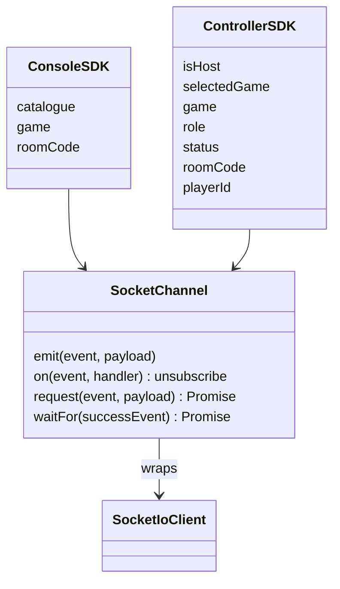
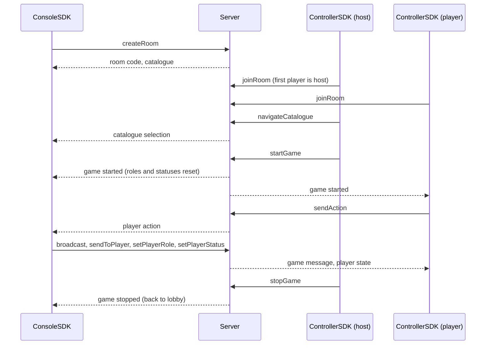

# SDK architecture

The SDK (`sdk/`) is the only way the web app and the games talk to the server. This page explains how
it is built. For the list of methods and callbacks, see the
[SDK reference](../game-dev/sdk-reference.md). For the wire protocol, see
[Real-time protocol](realtime-protocol.md).

## Role

The SDK is a thin, typed client of the real-time protocol. It is **not a game engine**: it does not
draw, run game loops or hold game rules. It connects, joins rooms, sends and receives messages, and
keeps the few pieces of state that every game needs (room code, catalogue, running game, role).

It exposes two classes:

- `ConsoleSDK` for the shared screen.
- `ControllerSDK` for the phone.

Both are generic: `ConsoleSDK<A, M>` and `ControllerSDK<A, M>`, where `A` is the map of actions
(controller to screen) and `M` the map of messages (screen to controllers). The default is
`MessageMap = Record<string, unknown>`. Constructors take `{ serverUrl, debug? }`, and the controller
also takes `playerId?` to rejoin with a known id.

The SDK is built with tsdown into ESM, CJS and type declarations. Rebuild it
(`cd sdk && npm run build`) before the web app sees a change.

## Structure

`SocketChannel` (`sdk/src/channel.ts`) is internal and not exported. It wraps the socket.io-client
socket. It is called a channel, not a transport, because "transport" already means WebSocket or
polling in Socket.IO.

The reason for this layer is isolation: when games run in iframes, a `PostMessageChannel` can replace
the socket behind a shared `Channel` interface without changing the public API
([ADR 0001](../adr/0001-game-packages-and-launch.md)). That interface does not exist yet.

## Three exchange modes

| Mode            | Channel method | Used by                                                                     | Behaviour                                                                    |
| --------------- | -------------- | --------------------------------------------------------------------------- | ---------------------------------------------------------------------------- |
| Request         | `request`      | `sendToPlayer`, `setPlayerRole`, `setPlayerStatus`, `startGame`, `stopGame` | Socket.IO acknowledgement, 5000 ms timeout. Resolves on `{ ok: true }`       |
| Fire-and-forget | `emit`         | `broadcast`, `sendAction`, `navigateCatalogue`                              | No answer, lowest latency                                                    |
| Legacy wait     | `waitFor`      | `createRoom`, `reconnectToRoom`, `joinRoom`                                 | Waits for a success event or the `error` event; rejects with a plain `Error` |

## Errors

A failed `request` rejects with a `PanicControlError` that carries the server's error code
(see the [error codes](realtime-protocol.md#error-codes)). Two codes come from the SDK: `TIMEOUT`
(no answer within 5 s) and `BAD_RESPONSE` (malformed answer). Legacy calls reject with a plain
`Error` holding the server message.

## State and listeners

Internal state is updated by listeners registered in the constructor, before any callback given by
the game. When a game callback runs, the state is already up to date.

| Class           | State                         | Updated by                                                         |
| --------------- | ----------------------------- | ------------------------------------------------------------------ |
| `ConsoleSDK`    | `catalogue`, `selectedGameId` | `catalogue`, `catalogue_selection`                                 |
|                 | `game`                        | set on `game_started`, cleared on `game_stopped`                   |
|                 | `roomCode`                    | room creation and reconnection                                     |
| `ControllerSDK` | `isHost`                      | `player_joined`, `promote_to_host`                                 |
|                 | `selectedGame`                | `catalogue_selection`                                              |
|                 | `game`                        | `game_started`, `game_stopped`                                     |
|                 | `role`, `status`              | `player_state`; reset to null on `game_started` and `game_stopped` |
|                 | `roomCode`, `playerId`        | join                                                               |

State is not reset on disconnect. Event listeners return an unsubscribe function.

## Typing

Messages are typed through the generics `A` and `M`. A helper type (`DataArgs`) makes the `data`
argument follow the map: required when the message type declares data, forbidden when it declares
none, optional when the data type allows `undefined`. A wrong type name or payload is a compile-time
error in the game.

## Debug

Off by default. With `debug: true` the SDK logs connection and disconnection as `[PanicControl] ...`.
The web app turns it on with `VITE_SDK_DEBUG=true`.

## Game lifecycle

Today the game pages declared by a manifest (`entry.screen`, `entry.controller`) are validated but not
loaded: the console and the controllers show a waiting panel while a game is "running".

## Isolation plan

Games will run in sandboxed iframes and talk to the host page through `postMessage`, with a watchdog
that returns the room to the lobby if a game freezes, without losing the room. The `SocketChannel`
abstraction is the first step. The decision, the launch flow and the alternatives are in
[ADR 0001](../adr/0001-game-packages-and-launch.md). For game authors, see the
[game developer guide](../game-dev/README.md).

## Not yet available

- A shared `Channel` interface and a `PostMessageChannel`.
- Game pages loaded in iframes, and the watchdog.
- Latency measurement and the developer mode.
- Controller layout, vibration and other sensor helpers.
- Automatic state reset on disconnect.
- SDK tests beyond placeholders.
